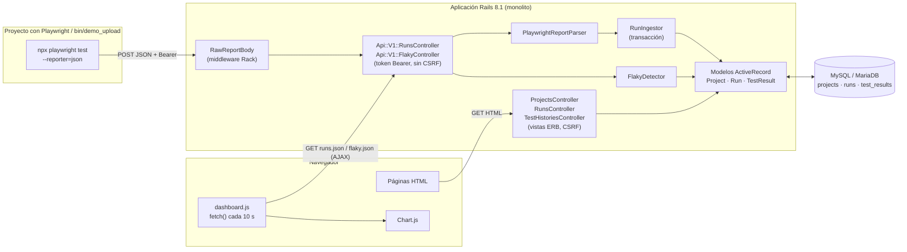
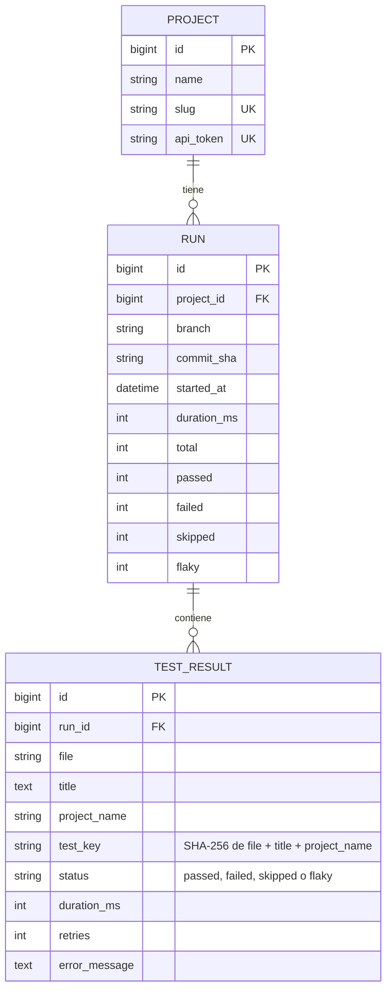

# QA Pulse

Tablero de resultados de pruebas: recibe reportes JSON de **Playwright**, guarda cada ejecución en
**MySQL** y muestra la tendencia de aprobadas/fallidas y las **pruebas inestables (flaky)**.

Proyecto final de la materia **Sistemas Web**. Construido con **Ruby on Rails 8.1**.

| Página | Qué muestra |
|---|---|
| **Proyectos** (`/`) | Lista de proyectos y formulario para crear uno; muestra el token de la API y el comando `curl` listo para copiar. |
| **Tablero** (`/projects/:slug`) | Tarjetas de la última ejecución, gráfica de las últimas 20 ejecuciones y tabla de pruebas inestables. Todo se carga por **AJAX** y se refresca cada 10 s. |
| **Ejecución** (`/projects/:slug/runs/:id`) | Todos los resultados, filtrables por estado sin recargar; los fallidos se expanden para ver el error. |
| **Historial de prueba** (`/projects/:slug/tests/:test_key`) | Los últimos 20 estados de una prueba como tira de colores, y sus duraciones. |

---

## 1. Requisitos

- **Ruby 3.3 o superior** (probado con 3.4.13) y Bundler.
- **MySQL 8 o MariaDB 10.4+**. Con **XAMPP** basta con encender el módulo *MySQL* en el panel de control.
- Opcional: **Docker**, solo para correr las pruebas end-to-end con Playwright.

> **Windows + XAMPP:** instala Ruby con [RubyInstaller](https://rubyinstaller.org/) *con DevKit*. La gema
> `mysql2` necesita las librerías cliente de MySQL/MariaDB; si `bundle install` falla al compilarla, indícale
> la carpeta de MySQL de XAMPP: `bundle config build.mysql2 --with-mysql-dir="C:/xampp/mysql"`.
> Los scripts `bin/demo_upload` y `bin/e2e` son de bash: en Windows ejecútalos desde **Git Bash**.

## 2. Instalación con XAMPP

```bash
# 1. Enciende MySQL en el panel de XAMPP (puerto 3306).

# 2. Instala las gemas (quedan dentro del proyecto, en vendor/bundle)
bundle config set --local path vendor/bundle
bundle install

# 3. Crea la base de datos, las tablas y los datos de demostración
bin/rails db:setup

# 4. Arranca el servidor
bin/rails server
```

Abre <http://127.0.0.1:3000>.

### Conexión a la base de datos

`config/database.yml` lee estas variables de entorno. Si no existen, usa los valores por defecto de XAMPP:

| Variable | Por defecto | Uso |
|---|---|---|
| `DB_USER` | `root` | Usuario de MySQL |
| `DB_PASSWORD` | *(vacía)* | Contraseña |
| `DB_HOST` | `127.0.0.1` | Servidor |
| `DB_PORT` | `3306` | Puerto |

Ejemplo con otra contraseña: `DB_PASSWORD=secreto bin/rails db:setup`.

Sin XAMPP (por ejemplo en Linux) se puede usar MySQL en Docker con las mismas credenciales:

```bash
docker run -d --name qapulse-mysql -p 3306:3306 -e MYSQL_ALLOW_EMPTY_PASSWORD=yes mysql:8.4
```

### Datos de demostración

`bin/rails db:setup` (o `bin/rails db:seed`, que se puede repetir) crea el proyecto **Tienda Demo** con
**15 ejecuciones** de **30 pruebas**:

- **3 pruebas inestables:** *cierra sesión por inactividad*, *filtra por rango de precio* y *actualiza el contador del ícono*.
- **1 regresión:** *Checkout > aplica un cupón de descuento* pasaba y falla en las 3 ejecuciones más recientes.
  Cambió de estado una sola vez, así que **no** se marca como inestable: es una falla real.
- 1 prueba siempre omitida (*paga con PayPal*).

## 3. Subir un reporte

### Desde un proyecto de Playwright

```bash
npx playwright test --reporter=json > playwright-report.json

curl -X POST "http://127.0.0.1:3000/api/v1/projects/<slug>/runs?branch=main&commit_sha=<sha>" \
  -H "Authorization: Bearer <api_token>" \
  -H "Content-Type: application/json" \
  --data-binary @playwright-report.json
```

El token y el comando exacto aparecen en la página **Proyectos** al crear un proyecto, y en el tablero
(*Cómo subir un reporte a este proyecto*).

### Subida en vivo para la demo

```bash
bin/demo_upload                       # sube spec/fixtures/playwright_report.json a "tienda-demo"
bin/demo_upload tienda-demo feature/x # otro proyecto o rama
```

El script lee el token de la base de datos y pone la fecha del reporte en "ahora", para que la ejecución
aparezca al final de la gráfica. Con el tablero abierto, **la nueva ejecución aparece en menos de 10 segundos
sin recargar la página**.

El reporte de ejemplo es real: se generó corriendo la suite de `spec/fixtures/playwright_suite/`
(30 pruebas, `retries: 2`). Para regenerarlo con Docker:

```bash
cd spec/fixtures/playwright_suite
docker run --rm -u "$(id -u):$(id -g)" -e HOME=/tmp -v "$PWD":/work -w /work \
  mcr.microsoft.com/playwright:v1.59.0-noble \
  bash -c 'npm install --silent && npx playwright test --reporter=json > report.json'
mv report.json ../playwright_report.json
```

## 4. API JSON

| Método y ruta | Descripción |
|---|---|
| `POST /api/v1/projects/:slug/runs` | Sube un reporte. Encabezado `Authorization: Bearer <api_token>`. Cuerpo: la salida de `--reporter=json`. `branch` y `commit_sha` son opcionales (en la URL o en el JSON). |
| `GET /api/v1/projects/:slug/runs.json?limit=20` | Resúmenes de las últimas ejecuciones (1–100), del más antiguo al más reciente: listos para graficar. |
| `GET /api/v1/projects/:slug/flaky.json?window=10` | Pruebas inestables ordenadas por puntuación, con cambios de estado y último error. |

Respuestas del `POST`:

| Código | Cuándo |
|---|---|
| **201** | Ejecución guardada. Devuelve el resumen (`total`, `passed`, `failed`, `skipped`, `flaky`, `pass_rate`, `url`, …). |
| **401** | Falta el token, es incorrecto o es de otro proyecto. |
| **413** | El reporte pesa más de 10 MB. |
| **422** | JSON inválido o que no es un reporte de Playwright. |

Los errores usan el formato estándar **RFC 9457** (`application/problem+json`). El catálogo está en
`docs/build/contracts/errors.md`.

**Los totales nunca se toman del cliente:** se ignoran los contadores de `stats` del reporte y se calculan con
`COUNT` sobre los resultados guardados. Además, una restricción `CHECK` de MySQL impide guardar totales que no cuadren.

### Cómo se lee el reporte de Playwright

```
suites[]  (una por archivo)
 └─ suites[]  (describe anidados, a cualquier profundidad)
     └─ specs[]  (title, file)
         └─ tests[]  (projectName = navegador, status)
             └─ results[]  (un elemento por intento: status, retry, duration, error)
```

- El título guardado es la ruta completa: `Checkout > Pago > rechaza una tarjeta vencida`.
- `expected` → **passed**, `unexpected` → **failed**, `skipped` → **skipped**.
- **flaky:** el último intento pasó después de un intento fallido (Playwright lo marca `flaky`; se verifica también con los intentos).
- Se guarda el mensaje de error sin los códigos de color ANSI.

## 5. Regla de prueba inestable (flaky)

En las **últimas 10 ejecuciones** del proyecto, una prueba es inestable si cumple al menos una condición:

1. Playwright la marcó **flaky** en alguna ejecución (falló y pasó al reintentar), **o**
2. su estado **cambió entre "passed" y "failed" al menos 2 veces** (las omitidas no cuentan).

Se muestran las veces flaky, el número de cambios y el último mensaje de error. Se ordenan por
*veces flaky + cambios*. Implementación: `app/services/flaky_detector.rb`.

## 6. Pruebas

```bash
bundle exec rspec    # 78 ejemplos: parser, API, modelos, regla flaky, páginas, seeds
bin/e2e              # 5 recorridos en un navegador real (Playwright en Docker); requiere el servidor encendido
```

| Archivo | Qué prueba |
|---|---|
| `spec/services/playwright_report_parser_spec.rb` | Parser contra el reporte real: conteos, flaky, suites anidadas, errores sin ANSI, entradas inválidas |
| `spec/requests/api/runs_spec.rb` | API: 201, 401, 413, 422; conteos manipulados ignorados; transacción sin datos a medias |
| `spec/services/flaky_detector_spec.rb` | Regla flaky: ventana de 10, cambios, regresión ≠ inestable, aislamiento por proyecto |
| `spec/requests/pages_spec.rb` | Páginas: escape de HTML, CSRF, strong params, una ejecución de otro proyecto da 404 |
| `spec/models/*`, `spec/seeds_spec.rb` | Restricciones de la BD, tokens, seeds repetibles |
| `e2e/tests/qa_pulse.spec.ts` | AJAX en vivo, filtro, historial, alta de proyecto, sin XSS en lo pintado por JavaScript |

## 7. Arquitectura



Flujo de una subida: el middleware evita que Rails interprete el cuerpo como parámetros. El controlador valida el
tamaño (≤ 10 MB) y el token (`secure_compare`), y el parser recorre las suites de forma recursiva. El *ingestor*
guarda la ejecución y sus resultados en **una sola transacción** y recalcula los totales. Después, el tablero
abierto detecta la nueva ejecución en su siguiente consulta AJAX.

### Modelo de datos



Índices: `runs(project_id, started_at)` para "últimas N ejecuciones", `test_results(test_key, run_id)` para el
historial de una prueba y `test_results(run_id, status)`. `test_key` es un hash de la identidad de la prueba: el
título puede ser largo (TEXT) y la colación de MySQL no distingue mayúsculas, así que el hash da un índice
compacto y exacto.

## 8. Tecnologías usadas

Esta sección señala dónde cumple el proyecto cada requisito de la materia.

### Base de datos — MySQL

- **Esquema y migraciones:** `db/migrate/` y `db/schema.rb`. Tres tablas relacionadas con llaves foráneas
  (`projects` → `runs` → `test_results`).
- **Integridad en la propia base de datos:** restricciones `CHECK` (`status` válido, conteos no negativos,
  `total = passed + failed + skipped + flaky`), `NOT NULL` e índices únicos (`slug`, `api_token`).
- **Consultas:** `app/services/flaky_detector.rb` (últimas N ejecuciones con `JOIN`), `Run#recompute_counts!`
  (`GROUP BY status`) y `TestHistoriesController` (historial por `test_key`).
- **Transacciones:** `app/services/run_ingestor.rb`. Si algo falla, no queda ninguna ejecución a medias.
- **Configuración por entorno:** `config/database.yml` (`DB_USER`, `DB_PASSWORD`, `DB_HOST`, `DB_PORT`).

### JSON — API REST

- **Entrada:** `POST /api/v1/projects/:slug/runs` recibe el reporte JSON de Playwright
  (`app/controllers/api/v1/runs_controller.rb`, `app/services/playwright_report_parser.rb`).
- **Salida:** `runs.json` y `flaky.json` (`app/controllers/api/v1/`), consumidos por el tablero.
- **Errores en JSON estándar** (RFC 9457): `app/controllers/api/v1/base_controller.rb`.

### AJAX — `fetch` sin recargar la página

- `app/javascript/qa/dashboard.js`: pide `runs.json` y `flaky.json` con `fetch`, dibuja la gráfica con Chart.js,
  actualiza las tarjetas y la tabla de inestables, y **repite cada 10 segundos**. Se pausa si la pestaña está oculta.
- Cada zona asíncrona tiene estados de *cargando*, *vacío*, *error* (conservando los últimos datos) y *éxito*.
- `app/javascript/qa/run_filter.js`: filtra los resultados de una ejecución en el cliente.

### Framework — Ruby on Rails 8.1

- **MVC:** modelos `app/models/`, vistas ERB `app/views/`, controladores `app/controllers/`, más
  servicios en `app/services/`.
- **Rutas REST:** `config/routes.rb` (namespace `api/v1` para la API y recursos anidados para las páginas).
- **ActiveRecord** (ORM, validaciones, asociaciones), **migraciones**, **seeds**, **strong parameters**,
  **importmap** para JavaScript (sin Node ni empaquetador) y **RSpec + FactoryBot** para pruebas.

### Seguridad

- **Escape de salida:** todo se imprime con `<%= %>` (Rails escapa el HTML); no se usa `raw` ni `html_safe`. En
  JavaScript los datos se insertan con `textContent`, nunca con `innerHTML` (`app/javascript/qa/dom.js`).
  Hay pruebas con `<script>` en títulos, ramas y errores.
- **CSRF:** los formularios HTML llevan `authenticity_token`. La API hereda de `ActionController::API`, que no
  usa CSRF, y se autentica con token.
- **Token:** se compara con `ActiveSupport::SecurityUtils.secure_compare` (`app/models/project.rb`). Un slug
  inexistente responde igual que un token incorrecto (401), así no se revela qué proyectos existen.
- **Límite de 10 MB** por reporte (413), revisado antes de autenticar y de parsear.
- **Content-Security-Policy** estricta (`config/initializers/content_security_policy.rb`): solo scripts propios
  con *nonce*; Chart.js está descargado en `vendor/javascript`, sin CDN.
- **Strong parameters** en el alta de proyectos y en `branch`/`commit_sha`.

## 9. Guion sugerido para la presentación

1. `bin/rails db:seed` para dejar los datos limpios. Abre **Tienda Demo**.
2. Explica las tarjetas, la gráfica y la regla de inestabilidad (el recuadro "¿Cómo se decide?").
3. Abre *filtra por rango de precio* → la tira muestra el ir y venir entre verde y rojo.
4. Compáralo con *aplica un cupón de descuento*: verde y luego siempre rojo. Es una regresión, no inestabilidad.
5. Con el tablero visible, en una terminal: `bin/demo_upload`. En ≤ 10 s aparece la nueva ejecución sin recargar.
6. Abre la ejecución, filtra por **Falló** y expande el error.
7. Crea un proyecto nuevo y muestra el token y el comando `curl` generados.

## 10. Estructura

```
app/controllers/api/v1/   API JSON (runs, flaky)
app/controllers/          páginas HTML
app/services/             parser, ingestor, regla flaky
app/javascript/qa/        AJAX, filtro y copiar (importmap)
lib/middleware/           RawReportBody
db/                       migraciones, schema, seeds
spec/                     RSpec + fixture real de Playwright
e2e/                      pruebas end-to-end con Playwright
docs/build/               decisiones de diseño (ADR), esquema, contrato de errores, bitácora
```
